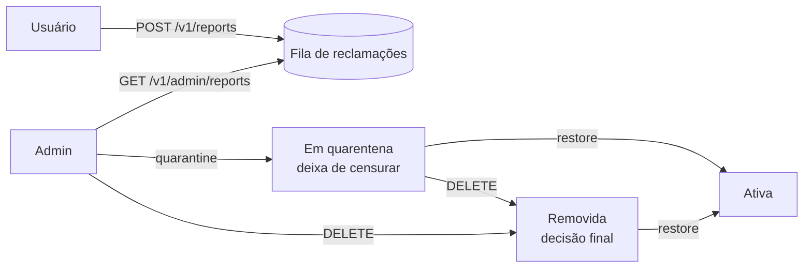
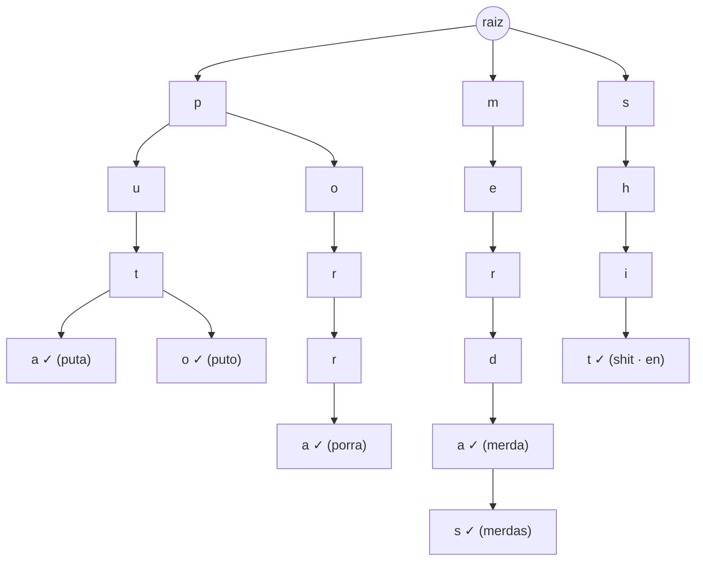
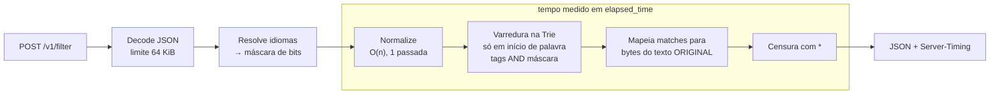

# 🛡️ Profanity Filter — Filtro de Palavrões Multi-idioma em Microssegundos


API HTTP de filtro de palavrões (*profanity filter*) com foco em **português do Brasil** e suporte a **vários idiomas** (PT-BR e inglês incluídos). É escrita em Go puro, só com a biblioteca padrão.
A detecção roda em uma **Árvore Trie em memória**, sobre o texto **normalizado**: caixa baixa, sem acentos, com leetspeak convertido, separadores removidos e letras gêmeas de outros alfabetos trocadas pelas latinas (o `а` russo de `putа` vira `a`). Cada requisição escolhe os idiomas que quer filtrar, e o texto é varrido **uma única vez**, seja qual for a combinação.

| Cenário (benchmark, CPU i7-13620H, mediana de 5 execuções) | Tempo por texto | Alocações |
|---|---:|---:|
| Frase limpa (45 bytes) | **~250 ns** | 0 |
| Frase com 2 palavrões | **~470 ns** | 3 |
| Mesma frase, dicionário com **10.009 palavras** | **~535 ns** | 3 |
| Frase mista PT/EN, listas reais (381 palavras) | **~720 ns** | 4 |
| Texto de 1 KB | **~6,9 µs** | 6 |

> Com **830× mais palavras** no dicionário, a mesma frase fica só ~13% mais lenta, e isso é efeito de cache de CPU, não do algoritmo. **O custo por caractere não depende do tamanho do dicionário.**

**Para ver funcionando:** rode `go run ./cmd/server` e abra **http://localhost:8080**. Há uma página onde você digita e vê a censura, as palavras encontradas e o tempo, ao vivo.

> 📚 **Documentação técnica com diagramas** em [docs/](docs/README.md): [arquitetura](docs/arquitetura.md), [API](docs/api.md), [motor de busca](docs/motor-de-busca.md) e [moderação](docs/moderacao.md).

---

## Sumário

- [Exemplo rápido](#exemplo-rápido)
- [Como rodar](#como-rodar)
- [Idiomas](#idiomas)
- [Moderação: reclamações e quarentena](#moderação-reclamações-e-quarentena)
- [Referência da API](#referência-da-api)
- [Por que uma Trie e não um banco de dados?](#por-que-uma-trie-e-não-um-banco-de-dados)
- [Arquitetura](#arquitetura)
- [Decisões de engenharia](#decisões-de-engenharia)
- [Benchmarks](#benchmarks)
- [Limitações e próximos passos](#limitações-e-próximos-passos)
- [Estrutura do projeto](#estrutura-do-projeto)

---

## Exemplo rápido

```http
POST /v1/filter
Content-Type: application/json

{ "text": "Que p0rr4 de jogo, o juiz é um d3sgr4çad0 e o VAR uma m.e.r.d.a!!" }
```

```json
{
  "has_profanity": true,
  "censored_text": "Que ***** de jogo, o juiz é um ********** e o VAR uma *********!!",
  "matches": [
    { "text": "p0rr4",      "word": "porra",      "start": 4,  "end": 9,  "languages": ["pt-br"] },
    { "text": "d3sgr4çad0", "word": "desgracado", "start": 31, "end": 41, "languages": ["pt-br"] },
    { "text": "m.e.r.d.a",  "word": "merda",      "start": 54, "end": 63, "languages": ["pt-br"] }
  ],
  "languages": ["pt-br"],
  "detected_languages": ["pt-br"],
  "elapsed_time": "4.2µs",
  "elapsed_time_ns": 4200
}
```

Repare que:

- `p0rr4`, `d3sgr4çad0` e `m.e.r.d.a` foram detectados apesar das tentativas de burlar o filtro;
- a censura acontece no **texto original**: acentos, maiúsculas e pontuação das partes limpas (`é`, `!!`) continuam intactos;
- `computador` **não** seria censurado, mesmo contendo "puta" (ver [problema de Scunthorpe](#1-fronteira-de-palavra-o-problema-de-scunthorpe));
- `matches` diz o que foi encontrado, a que palavra do dicionário corresponde e onde está (posição em caracteres, válida tanto no texto original quanto no censurado).

---

## Como rodar

**Pré-requisito:** Go 1.24 ou superior.

```bash
# Rodar direto
go run ./cmd/server

# Só português por padrão
DEFAULT_LANGUAGES=pt-br go run ./cmd/server

# Ou compilar um executável único (as listas vão embutidas nele)
go build -o server ./cmd/server
```

No **PowerShell**:

```powershell
$env:DEFAULT_LANGUAGES = "pt-br"; go run ./cmd/server
```

Testando:

```bash
curl -X POST http://localhost:8080/v1/filter \
     -H "Content-Type: application/json" \
     -d '{"text": "que m3rd4, what the fuck", "languages": ["pt-br", "en"]}'
```

```powershell
Invoke-RestMethod -Method Post -Uri http://localhost:8080/v1/filter `
  -ContentType "application/json; charset=utf-8" `
  -Body '{"text": "que m3rd4, what the fuck", "languages": ["pt-br", "en"]}'
```

### Playground

Com o servidor rodando, abra **http://localhost:8080**:

- o texto é filtrado **enquanto você digita**, e as palavras censuradas viram tarjas vermelhas;
- uma tabela mostra o que foi encontrado e a que palavra do dicionário corresponde;
- dá para escolher idiomas, o modo de censura (`*****` ou `p****`) e o caractere;
- uma **régua de latência** em escala logarítmica (1 ns → 1 s) posiciona o tempo do algoritmo ao lado de referências conhecidas (acesso à RAM, leitura em SSD, rede, piscar de olhos) e da ida e volta real pelo navegador. Isso deixa claro quanto do tempo é o filtro e quanto é a rede;
- botões de exemplo mostram leetspeak, separadores, letras repetidas, palavra inocente (`computador`) e dois idiomas.

A página é HTML, CSS e JavaScript puros, embutidos no binário com `go:embed`, e é servida com uma **Content-Security-Policy estrita** (sem `unsafe-inline`): só scripts, estilos e chamadas da própria origem.

### Configuração

| Variável | Padrão | Descrição |
|---|---|---|
| `PORT` | `8080` | Porta HTTP |
| `DEFAULT_LANGUAGES` | *todos, menos os `-strict`* | Idiomas aplicados quando a requisição não envia `languages`. Separados por vírgula: `pt-br` ou `pt-br,en`. Um código inválido impede o servidor de subir, então o erro aparece no deploy e não em produção. |
| `WORDLIST_DIR` | *(listas embutidas)* | Pasta com os arquivos `<idioma>.txt`. Sem ela, são usadas as listas de [wordlists/](wordlists), compiladas dentro do binário. |
| `STATE_FILE` | `data/state.json` | Onde ficam reclamações, quarentenas e remoções. A pasta é criada automaticamente. |
| `ADMIN_TOKEN` | *(vazio)* | Token das rotas `/v1/admin/*`. Sem ele, essas rotas ficam desligadas (`403`). |

---

## Idiomas

### Um arquivo por idioma

Os dicionários ficam em [wordlists/](wordlists), um arquivo por idioma, e o **nome do arquivo é o código do idioma**:

```
wordlists/
├── en.txt             →  "en"            (94 entradas)
├── pt-br.txt          →  "pt-br"         (180 entradas)
├── pt-br-strict.txt   →  "pt-br-strict"  (107 entradas, opcional)
└── embed.go           →  embute os .txt no binário (go:embed)
```

Formato: uma palavra ou expressão por linha, com `#` para comentários. Maiúsculas e acentos não importam.

```text
# Palavrões
porra
merda
merdas
# Expressões com espaço também funcionam
filho da puta
```

**Para adicionar um idioma**, crie `wordlists/es.txt` (por exemplo) e reinicie. Não é preciso mexer em código. O idioma aparece em `GET /v1/languages` e pode ser usado em `"languages": ["es"]`.

> As listas incluem flexões (plural, feminino, conjugações), porque a busca é por **palavra inteira**. Cada arquivo também documenta, num comentário no topo, as palavras **deixadas de fora de propósito** por serem ambíguas.

### Modo estrito (dicionários opcionais)

Muitas palavras são ofensivas só em um contexto: `vaca`, `cachorro`, `peru`, `rabo`, `rolinha`, `piranha`. Colocá-las no filtro padrão censuraria "comprei um peru para o Natal". Elas ficam em `pt-br-strict.txt`.

Todo dicionário cujo nome termina em **`-strict`** é **opcional**: ele nunca entra no padrão e só é aplicado quando pedido explicitamente. Isso é útil, por exemplo, numa plataforma infantil:

```json
{ "text": "sua vaca", "languages": ["pt-br", "pt-br-strict"] }
```

Algumas palavras ficam **fora de todas as listas**, inclusive da estrita:

- **termos de identidade** (`gay`, `lésbica`, `homossexual`): censurá-los é um erro clássico de moderação, que pune justamente quem está sendo atacado;
- **palavras neutras** que aparecem em listas prontas da internet (`coco`, `furo`, `defunto`, `cassete`, `ladrão`). Há testes de regressão garantindo que continuem passando.

### Escolhendo idiomas

São dois níveis de configuração:

1. **Padrão do servidor**: `DEFAULT_LANGUAGES=pt-br`.
2. **Por requisição**: `"languages": ["pt-br", "en"]`, que substitui o padrão. Os códigos não diferenciam maiúsculas (`PT-BR` = `pt-br`).

A escolha importa. `cu` é palavrão em português, mas `cu later` é inglês inocente de chat:

| `languages` | Texto | `censored_text` |
|---|---|---|
| `["pt-br"]` | `cu later, that is bullsh1t` | `** later, that is bullsh1t` |
| `["en"]` | `cu later, that is bullsh1t` | `cu later, that is ********` |
| `["pt-br", "en"]` | `cu later, that is bullsh1t` | `** later, that is ********` |

### Como funciona por dentro: uma Trie, uma máscara de bits

A solução óbvia seria uma Trie por idioma. Mas então uma requisição com 3 idiomas varreria o texto 3 vezes e ainda teria de mesclar os resultados.

Aqui **todos os idiomas vivem na mesma Trie**. Cada nó onde uma palavra termina guarda um `uint64` com **um bit por idioma**:

```
                      tags (bit 0 = en, bit 1 = pt-br)
"merda"     ──▶  0b10   (só pt-br)
"shit"      ──▶  0b01   (só en)
"x"         ──▶  0b11   (se estivesse nas duas listas)
```

A requisição vira um conjunto de bits (`["pt-br"]` → `0b10`), e durante a varredura uma palavra só "existe" se `tags & pedido != 0`. O resultado:

- **uma única varredura** do texto, para 1 ou 64 idiomas;
- prefixos compartilhados **entre idiomas** (`ass` e `asshole` dividem nós; `puta` e `puto` também);
- a seleção de idioma custa **um `AND` de CPU** por palavra candidata;
- `detected_languages` sai de graça: é o `OR` das tags de cada palavra encontrada.

---

## Moderação: reclamações e quarentena

Nenhuma lista é perfeita. Quando os usuários acham que uma palavra não deveria ser censurada, o fluxo é este:



| Estado | Censura? | Significado |
|---|---|---|
| `active` | sim | Normal |
| `quarantined` | não | Suspensa enquanto o admin avalia. As reclamações ficam guardadas como evidência. |
| `removed` | não | Decisão final. As reclamações são encerradas, e novas reclamações são recusadas (`409`). |

**Decisões de design:**

- **Reclamar é público; decidir é só do admin.** A quarentena **não** é automática ao atingir N reclamações. Se fosse, um grupo organizado poderia reportar `puta` 500 vezes e liberar o palavrão para todo mundo.
- **Um voto por cliente por palavra.** O mesmo IP reclamando de novo recebe `202`, mas com `"counted": false`. O IP é guardado só como **hash SHA-256 com *salt***: o arquivo de estado nunca contém endereços.
- **Persistente.** Tudo vai para `STATE_FILE` com **escrita atômica** (arquivo temporário + `rename`), e um crash nunca deixa o arquivo pela metade. Decisões do admin são gravadas antes da resposta `200`. Reclamações são agrupadas e gravadas a cada 5 s e no desligamento, para que uma rajada de reclamações não vire uma rajada de escritas em disco. Os `.txt` originais nunca são alterados.
- **Palavras normalizadas.** Pôr `V4CA` em quarentena afeta `vaca`, e remover `foda-se` também desativa `fodase`, porque as duas formas são a mesma palavra para o filtro.

### Trocando a Trie sem parar o servidor

A Trie é lida **sem lock** por todas as requisições, e não dá para mexer nela com o servidor rodando sem estragar essa garantia. A solução é **copy-on-write**:

1. o admin pede uma mudança e a escrita pega um mutex (só escritas esperam umas pelas outras);
2. uma **Trie nova** é montada com as listas base menos as palavras desativadas (~0,5 ms para ~400 palavras);
3. o estado é gravado em disco;
4. a Trie nova é publicada com **um único `atomic.Pointer.Store`**.

As requisições em andamento terminam com a Trie antiga, e as seguintes já pegam a nova. **Nenhuma leitura espera, e ninguém vê uma árvore pela metade.** Um batch usa o mesmo *snapshot* do início ao fim, então todos os textos dele são julgados pelas mesmas regras. Há um teste que alterna quarentena/restore 200 vezes enquanto 8 goroutines filtram texto sem parar.

---

## Referência da API

O contrato completo está em [api/openapi.yaml](api/openapi.yaml) (OpenAPI 3.1).

### `POST /v1/filter`

| Campo da requisição | Tipo | Obrigatório | Descrição |
|---|---|---|---|
| `text` | string | sim | Texto a ser analisado |
| `languages` | string[] | não | Idiomas a aplicar (incluindo os opcionais `-strict`). Se omitido, vale `DEFAULT_LANGUAGES` |
| `mask` | string | não | `"full"` (padrão: `*****`) ou `"first"` (mantém a primeira letra de cada palavra: `p****`) |
| `mask_char` | string | não | Um caractere visível que substitui as letras. Padrão `*`; aceita qualquer Unicode (`#`, `█`…) |

| Campo da resposta | Tipo | Descrição |
|---|---|---|
| `has_profanity` | boolean | Se algum palavrão foi detectado |
| `censored_text` | string | Texto original com cada palavra detectada mascarada (um caractere por caractere, então o tamanho não muda) |
| `matches` | object[] | Cada palavra encontrada: `text` (como foi escrita), `word` (forma no dicionário), `start`/`end` (posição em caracteres) e `languages` |
| `languages` | string[] | Idiomas aplicados nesta requisição |
| `detected_languages` | string[] | Idiomas em que algum palavrão foi encontrado |
| `elapsed_time` | string | Tempo do algoritmo, legível (`"4.2µs"`) |
| `elapsed_time_ns` | integer | O mesmo tempo, em nanossegundos |

A resposta também traz o cabeçalho `Server-Timing: filter;dur=<ms>`, que aparece na aba *Timing* do DevTools do navegador.

| Status | Quando |
|---|---|
| `200` | Sucesso |
| `400` | JSON inválido, `text` ausente, idioma desconhecido, `languages` vazio, `mask` ou `mask_char` inválidos |
| `405` | Método diferente de `POST` |
| `413` | Corpo maior que 64 KiB |

### `POST /v1/filter/batch`

Vários textos em uma chamada, com as mesmas regras do endpoint simples. Os resultados vêm **na mesma ordem** dos textos.

```json
{ "texts": ["que merda", "comprei um peru", "what the fuck"], "languages": ["pt-br", "en"] }
```

```json
{
  "results": [
    { "has_profanity": true,  "censored_text": "que *****",       "detected_languages": ["pt-br"] },
    { "has_profanity": false, "censored_text": "comprei um peru", "detected_languages": [] },
    { "has_profanity": true,  "censored_text": "what the ****",   "detected_languages": ["en"] }
  ],
  "count": 3,
  "profane_count": 2,
  "languages": ["en", "pt-br"],
  "elapsed_time": "7µs",
  "elapsed_time_ns": 7000
}
```

| Limite | Valor | Por quê |
|---|---|---|
| Textos por chamada | **100** | ~100 × poucos µs = bem menos de 1 ms de CPU |
| Tamanho de cada texto | 64 KiB | O mesmo do endpoint simples |
| Corpo total | 1 MiB | Teto de memória por requisição |

Os textos são processados **em sequência**, de propósito: cada um leva microssegundos, e criar goroutines para isso custaria mais do que economizaria.

### `POST /v1/reports`

O usuário reclama que uma palavra não é palavrão. Responde `202 Accepted`: a reclamação entra na fila, e nada muda até o admin decidir.

```json
{ "word": "puto", "language": "pt-br", "reason": "em PT-PT puto = menino" }
```
```json
{ "language": "pt-br", "word": "puto", "status": "active", "reports": 1,
  "reasons": ["em PT-PT puto = menino"], "counted": true,
  "first_reported_at": "2026-11-09T00:23:01Z", "last_reported_at": "2026-11-09T00:23:01Z" }
```

`404` se a palavra não está no dicionário, `409` se ela já está em quarentena ou removida.

### Rotas de admin

Todas exigem `Authorization: Bearer <ADMIN_TOKEN>`. Sem o token, respondem `401`; com `ADMIN_TOKEN` não configurado, `403`.

| Método e rota | O que faz |
|---|---|
| `GET /v1/admin/reports` | Fila de reclamações, as mais reclamadas primeiro |
| `GET /v1/admin/words` | Lista as palavras dos dicionários, com origem, status e reclamações |
| `POST /v1/admin/words` | Cadastra palavrões novos (até 100 por chamada) |
| `POST /v1/admin/words/{language}/{word}/quarantine` | Suspende a palavra (reversível) |
| `POST /v1/admin/words/{language}/{word}/restore` | Reativa e encerra as reclamações |
| `DELETE /v1/admin/words/{language}/{word}` | Remove de vez |

```bash
curl -X POST http://localhost:8080/v1/admin/words/pt-br/puto/quarantine \
     -H "Authorization: Bearer $ADMIN_TOKEN"
```

Toda ação de admin é registrada no log (ação, palavra, IP), o que serve de trilha de auditoria.

#### Listar palavras: `GET /v1/admin/words`

Cada linha dos `.txt` vira um item, mais as palavras cadastradas pela API. O campo `source` diz de onde a palavra veio:

```json
{
  "count": 2,
  "words": [
    { "language": "pt-br", "word": "desgraçado", "normalized": "desgracado",
      "source": "pt-br.txt", "status": "active", "reports": 0 },
    { "language": "pt-br", "word": "mané", "normalized": "mane",
      "source": "api", "status": "quarantined", "reports": 3,
      "added_at": "2026-11-09T00:32:39Z", "updated_at": "2026-11-09T01:10:02Z" }
  ]
}
```

| Filtro (query string) | Exemplo | Efeito |
|---|---|---|
| `language` | `?language=pt-br` | Só um idioma |
| `status` | `?status=quarantined` | `active`, `quarantined` ou `removed` |
| `source` | `?source=api` ou `?source=pt-br.txt` | De onde a palavra veio |
| `q` | `?q=fod` | Trecho da palavra; passa pela normalização, então `?q=f0d` também funciona |

Os filtros podem ser combinados: `?language=pt-br&source=api&status=active`.

#### Cadastrar palavras: `POST /v1/admin/words`

```json
{ "language": "pt-br", "words": ["mané", "otário", ""] }
```
```json
{
  "added":   [ { "language": "pt-br", "word": "mané", "normalized": "mane", "source": "api", "status": "active", ... } ],
  "skipped": [ { "word": "otário", "reason": "já existe (pt-br.txt)" },
               { "word": "",       "reason": "inválida: vazia depois da normalização" } ]
}
```

- Cada palavra é avaliada sozinha: uma repetida ou inválida não impede as outras. A resposta é `201` se ao menos uma entrou, ou `200` se nenhuma entrou.
- A palavra passa a ser censurada **na hora**, com todas as regras do motor (`m4n3` também é pego), e fica gravada no `state.json`. Os `.txt` não são alterados.
- Só idiomas que já existem (um `.txt` na pasta `wordlists/`). Máximo de 100 palavras por chamada e 64 caracteres por palavra.
- Texto com codificação errada é **recusado**, não "consertado". Se um terminal mandar `mané` em Latin-1, o `é` chega corrompido. Aceitar seria cadastrar `man`, que censuraria "the man" em qualquer texto em inglês.
- Uma palavra cadastrada pela API pode ser reclamada, posta em quarentena ou restaurada como qualquer outra. O `DELETE` apaga a palavra de vez, e ela pode ser cadastrada de novo depois.

### `GET /v1/languages`

```json
{
  "languages": [
    { "code": "en",           "words": 94,  "opt_in": false },
    { "code": "pt-br",        "words": 180, "opt_in": false },
    { "code": "pt-br-strict", "words": 107, "opt_in": true }
  ],
  "default": ["en", "pt-br"]
}
```

### `GET /health`

```json
{ "status": "ok", "languages": ["en", "pt-br", "pt-br-strict"], "words": 381, "trie_nodes": 1206 }
```

---

## Por que uma Trie e não um banco de dados?

A pergunta que um filtro de palavrões responde é: **"algum trecho deste texto é uma palavra do dicionário?"**. Repetida milhares de vezes por segundo, essa pergunta tem três abordagens óbvias:

| Abordagem | Custo por requisição | Problemas |
|---|---|---|
| **Banco de dados** (`WHERE texto LIKE '%' \|\| palavra \|\| '%'`) | Ida e volta na rede (**ordem de milissegundos**) + varredura de todas as palavras | I/O em todo request; o banco vira gargalo e ponto único de falha; `LIKE '%x%'` não usa índice |
| **Loop de `strings.Contains`** em memória | **O(W · n)**: para cada uma das *W* palavras, varre o texto de tamanho *n* | Fica mais lento a cada palavra adicionada; não entende fronteira de palavra |
| **Trie em memória** ✅ | **O(n · L)**: cada caractere do texto desce no máximo *L* níveis (tamanho da maior palavra) | — |

### O que a Trie traz

**1. O custo independe do tamanho do dicionário.**
Numa Trie, procurar uma palavra é descer um nível por letra. Ter 10 ou 100.000 palavras não muda quantos passos isso leva. O benchmark comprova: com **830× mais palavras**, a mesma frase custa só ~13% a mais.

**2. Prefixos compartilhados economizam memória e trabalho.**
Palavras com o mesmo começo dividem os mesmos nós. Ao ler `p-o-r`, a busca já descartou todas as palavras que não começam com "por", de uma vez:



**3. Zero I/O no caminho crítico.**
A árvore é montada **uma vez**, na inicialização, e fica na RAM. Nenhuma requisição toca disco, rede ou banco. É por isso que a latência fica em nanossegundos e não em milissegundos.

**4. Leitura sem lock.**
Depois de montada, a Trie nunca é modificada. Qualquer número de goroutines pode ler ao mesmo tempo sem mutex e sem contenção, então a vazão cresce com o número de núcleos.

**5. Busca por varredura, não por igualdade.**
Diferente de um índice de banco (que responde "esta palavra existe?"), a Trie permite **caminhar pelo texto caractere a caractere** e descobrir onde começa e termina cada ocorrência. É exatamente isso que a censura precisa.

> **Quando um banco ainda faz sentido?** Como **fonte da verdade** da lista de palavras (para editar via painel, auditar, versionar). O padrão recomendado é: o banco guarda a lista, e a aplicação carrega a lista numa Trie ao iniciar (ou ao receber um evento de atualização). Banco para *escrever*, Trie para *ler*.

---

## Arquitetura



### Pré-processamento (normalização)

Implementado em [internal/normalizer/normalizer.go](internal/normalizer/normalizer.go), numa única passada O(n):

| Regra | Exemplo |
|---|---|
| Caixa baixa | `MERDA` → `merda` |
| Leetspeak | `0→o`, `1→i`, `3→e`, `4→a`, `5→s`, `7→t`, `@→a`, `$→s`: `m3rd4` → `merda` |
| Remoção de acentos | `Desgraçado` → `desgracado`, `AÇÃO` → `acao` |
| Separadores removidos | `p.u.t.a`, `p*u*t*a`, `c-a-c-e-t-e` → `puta`, `cacete` |
| Espaços colapsados | `"a   \t b"` → `"a b"` |
| Marcas combinantes descartadas | `e` + `U+0301` (é decomposto) → `e` |

As listas de palavras passam pela **mesma** normalização na inicialização. Por isso `desgraçado` na lista também pega `DESGRACADO` e `d3sgr4c4d0`.

---

## Decisões de engenharia

### 1. Fronteira de palavra: o problema de Scunthorpe

Um filtro ingênuo censura `computador` (com-**puta**-dor), `cacetete` e `classic` (cl-**ass**-ic). O *matching* aqui só aceita ocorrências que **começam e terminam em uma fronteira**: borda do texto, espaço, ou um ponto onde um separador foi removido.

| Entrada | Resultado | Por quê |
|---|---|---|
| `computador` | não censura | "puta" está no meio da palavra |
| `a classic assassin` | não censura | "ass" está no meio das palavras |
| `puta!` | `****!` | `!` é separador, então é fronteira |
| `ola,merda` | `ola,*****` | vírgula colada também é fronteira |
| `foda-se` | `*******` | `fodase` está na lista; `foda` sozinho daria `****-se` |

### 2. Normalização que preserva posições

O texto normalizado tem tamanho diferente do original (`p.u.t.a` tem 7 bytes, `puta` tem 4; `ç` ocupa 2 bytes em UTF-8). Por isso, cada rune normalizada guarda o **intervalo de bytes de onde veio** (`Span`). Depois do match, a censura é aplicada ao **texto original**:

```
original:   p  .  u  .  t  .  a
normalizado: p     u     t     a      →  match [0,4) no normalizado
                                       →  bytes [0,7) no original  →  *******
```

### 3. Letras esticadas sem inflar o dicionário

`porrrraaaa` e `fuuuuck` são detectados **sem** cadastrar variações. Durante a descida na Trie, se uma letra não tem aresta mas repete a anterior, o cursor fica parado no nó atual. Isso funciona inclusive para palavras com letras duplas legítimas (`porra` tem `rr`), porque a aresta real sempre tem prioridade.

### 4. Zero alocações no caminho limpo

- Os buffers de normalização são reciclados com `sync.Pool`, então um servidor aquecido quase não pressiona o *garbage collector*.
- Texto limpo é devolvido **como está**, sem cópia: **0 alocações** por requisição.
- O caminho ASCII da decodificação UTF-8 é tratado à parte, já que é o caso mais comum em chat.

### 5. Nós com array fixo para o alfabeto comum

Depois da normalização, praticamente todo caractere é `a`–`z` ou espaço. Esses 27 filhos ficam num **array indexado diretamente** (`children[r - 'a']`), sem hash. Qualquer outro caractere (dígitos, outros alfabetos) cai num `map` alocado sob demanda, então o código continua correto para Unicode.

### 6. Tabela de classificação pré-computada

A decisão "esta rune é letra, espaço ou separador, e qual é a forma normalizada?" é pré-calculada numa tabela de 384 entradas (ASCII + Latin-1 + Latin Extended-A). Para todo caractere do português, a classificação custa **um acesso a array**.

### 7. Listas embutidas no binário, com `fs.FS`

Com `go:embed`, os `.txt` de [wordlists/](wordlists) são compilados para dentro do executável: o binário funciona sozinho, sem depender de arquivos ao lado. O carregador recebe um `fs.FS`, então **o mesmo código** lê as listas embutidas ou uma pasta no disco (`WORDLIST_DIR` → `os.DirFS`). Nos testes, ele lê um `fstest.MapFS` em memória.

### 8. Medição de tempo de alta resolução (inclusive no Windows)

No Linux e no macOS, `time.Now()` do Go tem resolução de nanossegundos. **No Windows**, o relógio monotônico só avança a cada tick do timer do sistema (0,5–15,6 ms), e uma operação de 4 µs aparece como `"0s"`. O pacote [internal/clock](internal/clock) usa `QueryPerformanceCounter` no Windows (resolução de ~100 ns) e o relógio padrão nos demais sistemas, via *build tags*.

### 9. Copy-on-write com `atomic.Pointer`

As mudanças de moderação trocam a Trie inteira de forma atômica, em vez de travar as leituras. Os detalhes estão em [Trocando a Trie sem parar o servidor](#trocando-a-trie-sem-parar-o-servidor).

### 10. Servidor pronto para produção

Timeouts de leitura/escrita (proteção contra *slowloris*), limites de corpo e de itens por requisição, *graceful shutdown* em `SIGINT`/`SIGTERM` (que também grava as reclamações pendentes), *recover* de panics, roteamento por método (`POST /v1/filter` responde `405` a `GET`), token de admin comparado em **tempo constante** (`crypto/subtle`, contra *timing attacks*), validação da configuração e do arquivo de estado na inicialização (*fail fast*).

---

## Benchmarks

```bash
go test -run='^$' -bench=. -benchmem -count=5 ./internal/...
```

Medianas de 5 execuções numa CPU Intel Core i7-13620H (notebook), Windows 11, Go 1.26:

| Benchmark | ns/op | B/op | allocs/op |
|---|---:|---:|---:|
| `Censor_ShortClean`: frase limpa, 45 bytes | 245 | 0 | 0 |
| `Censor_ShortProfane`: 2 palavrões | 473 | 176 | 3 |
| `Censor_LargeDictionary`: idem, 10.009 palavras | 535 | 176 | 3 |
| `Censor_EmbeddedLists`: frase PT/EN, listas reais | 718 | 352 | 4 |
| `Censor_1KB`: texto de 1 KB | 6.899 | 2.338 | 6 |
| `Normalize`: só a normalização, 70 bytes | 201 | 0 | 0 |

> Em notebook, os números variam ±20% entre execuções (turbo e temperatura). As **proporções** entre os cenários são estáveis.

> **Benchmark × `elapsed_time` da API.** O benchmark mede o algoritmo em regime estacionário, com cache de CPU quente e milhões de repetições. O `elapsed_time` de uma requisição isolada costuma ficar entre **3 e 12 µs**: cada requisição roda num goroutine novo, muitas vezes em outro núcleo, com cache frio, e a leitura do relógio também tem custo. Os dois números estão corretos; eles medem coisas diferentes.

---

## Testes

```bash
go test ./...           # testes unitários e de integração HTTP
go test -race ./...     # com detector de race (requer CGO no Windows)
```

A suíte cobre normalização, a Trie (incluindo a fusão de tags), o carregamento de listas, os cenários de evasão (leetspeak, separadores, letras esticadas, acentos), os falsos positivos clássicos (`computador`, `putaria`, `cacetete`, `classic`), a seleção de idiomas, os limites do batch, o ciclo de moderação (reclamar, quarentena, restaurar, remover), a persistência através de reinícios, leituras concorrentes durante a troca da Trie e todos os status HTTP.

---

## Limitações e próximos passos

Filtrar linguagem é um problema que nunca fica 100% resolvido. Algumas limitações conhecidas e como eu evoluiria o projeto:

- **Cobertura depende da lista**: o motor pega variações de escrita, mas não *inventa* palavras. Flexões e gírias novas precisam ser adicionadas aos `.txt`.
- **Até 64 idiomas** por instância (um bit de `uint64` cada), mais que suficiente na prática.
- **Normalização pensada para alfabeto latino**: idiomas como russo ou japonês funcionam (a Trie aceita qualquer rune), mas sem leetspeak e remoção de acentos específicos.
- **Aho-Corasick**: adicionar *failure links* à Trie torna a varredura **O(n)** de verdade, independente do tamanho da maior palavra.
- **Letras espaçadas** (`p u t a`) e **letras trocadas por símbolo** (`f*da`) ainda passam. Dá para tratar com uma heurística de junção de tokens de 1 letra e com *wildcards* na descida da Trie.
- **Várias instâncias**: o estado de moderação fica num arquivo local, ou seja, um por instância. Para escalar horizontalmente, ele iria para um banco (Postgres/Redis), e as instâncias seriam avisadas das mudanças por *pub/sub* para reconstruir a Trie.
- **IP atrás de proxy**: atrás de um *load balancer*, o IP visto é o do proxy. Nesse caso, seria preciso ler `X-Forwarded-For` de um proxy confiável.
- **Idiomas novos pela API**: palavras novas podem ser cadastradas pela API, mas um idioma novo ainda precisa de um `.txt` na pasta `wordlists/`.
- **Contexto semântico**: palavras ambíguas pedem um classificador, idealmente aplicado só depois que a Trie filtrou os candidatos.
- **Observabilidade**: métricas Prometheus (histograma de latência, taxa de detecção por idioma) e *rate limiting* por cliente.

---

## Estrutura do projeto

```
.
├── cmd/server/            # main: configuração, carga das listas, HTTP server, graceful shutdown
├── internal/
│   ├── api/               # handlers HTTP (filtro, batch, reclamações, admin), contrato JSON
│   ├── clock/             # cronômetro de alta resolução (QPC no Windows)
│   ├── filter/            # normalização + Trie + idiomas + censura; benchmarks
│   ├── moderation/        # reclamações, quarentena, remoção, persistência, troca atômica da Trie
│   ├── normalizer/        # higienização do texto com mapeamento de posições
│   ├── trie/              # Árvore de Prefixos com tags por palavra e cursor sem alocação
│   └── wordlist/          # leitura de listas a partir de qualquer fs.FS
├── wordlists/             # um <idioma>.txt por idioma (+ *-strict opcionais), embutidos no binário
├── web/                   # playground (HTML, CSS e JS sem framework), embutido no binário
├── data/                  # state.json da moderação (criado em tempo de execução, fora do git)
├── api/openapi.yaml       # contrato da API (OpenAPI 3.1)
├── docs/                  # documentação técnica com diagramas (Mermaid)
└── .github/workflows/     # CI: gofmt, vet, testes com -race, benchmarks
```

> ⚠️ As listas incluídas são um **ponto de partida**. Para produção, revise e adapte ao seu domínio: o que é ofensivo num chat de jogo pode ser legítimo num fórum de saúde.

---

## Licença

Distribuído sob a licença MIT. Veja [LICENSE](LICENSE).
