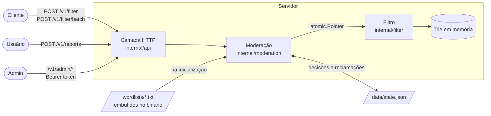

# Documentação

Documentação técnica do **Language Filter**, com diagramas de como o sistema funciona por dentro. Para instalar e rodar, veja o [README principal](../README.md).

Os diagramas usam [Mermaid](https://mermaid.js.org/), que o GitHub desenha automaticamente.

| Documento | O que explica |
|---|---|
| [Arquitetura](arquitetura.md) | Pacotes, inicialização, o caminho de uma requisição, concorrência e desligamento |
| [API](api.md) | Todas as rotas: o que recebem, o que devolvem, erros e autenticação |
| [Motor de busca](motor-de-busca.md) | Normalização, a Trie, a máscara de idiomas e o algoritmo de varredura, passo a passo |
| [Moderação](moderacao.md) | Reclamações, quarentena, cadastro de palavras, troca atômica da Trie e persistência |

## Visão geral em um diagrama

## Glossário

| Termo | Significado |
|---|---|
| **Trie** | Árvore de prefixos: cada nível é uma letra, e palavras com o mesmo começo dividem os mesmos nós. |
| **Normalização** | Transformar o texto antes da busca: minúsculas, sem acentos, leetspeak convertido (`m3rd4` → `merda`) e separadores removidos (`p.u.t.a` → `puta`). |
| **Fronteira de palavra** | Ponto onde uma palavra pode começar ou terminar: espaço, borda do texto ou um separador removido. É o que impede `computador` de ser censurado por conter "puta". |
| **LangSet** | Conjunto de idiomas representado como bits de um `uint64` (bit 0 = `en`, bit 1 = `pt-br`…). |
| **Snapshot** | Uma versão imutável da Trie. As requisições leem um snapshot; as mudanças criam um novo. |
| **Copy-on-write** | Em vez de alterar a Trie em uso, monta-se uma nova e troca-se o ponteiro de uma vez. |
| **Opt-in** | Dicionário `*-strict`, que só é aplicado quando pedido explicitamente. |
