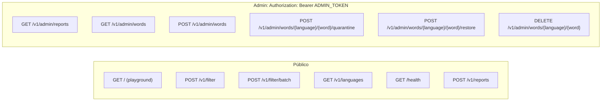
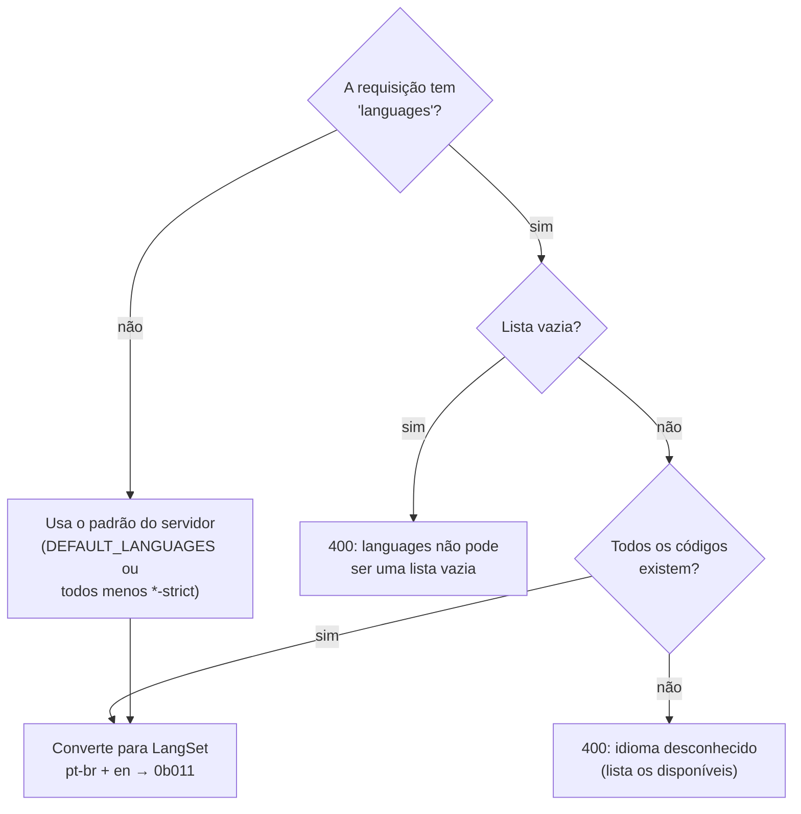
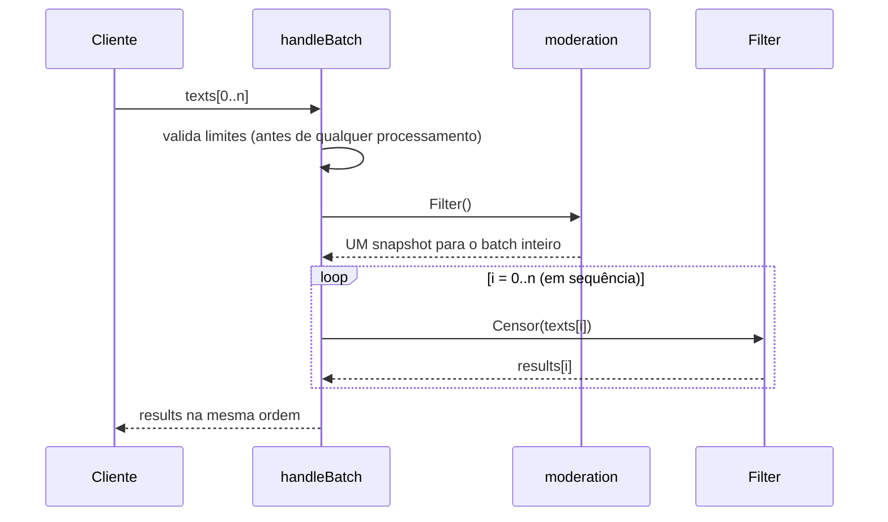
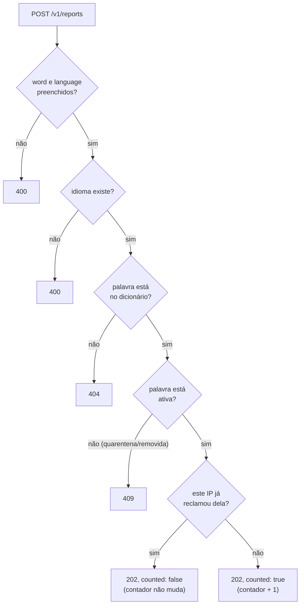
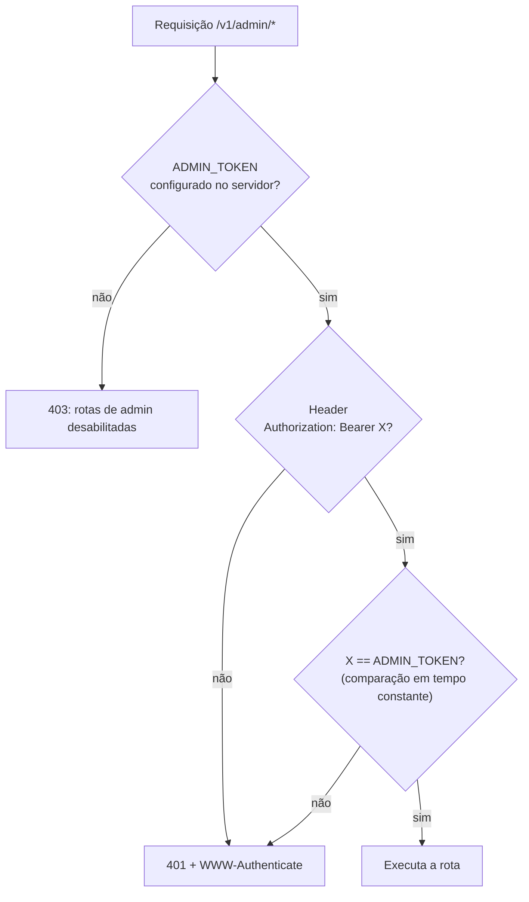
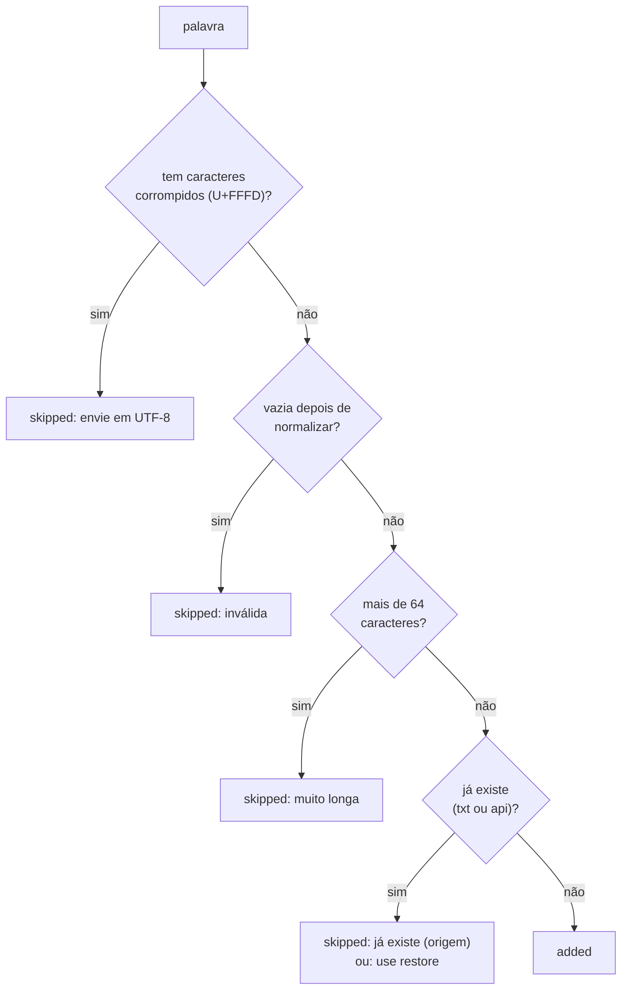

# API

[← Voltar ao índice](README.md)

O contrato formal (OpenAPI 3.1) está em [api/openapi.yaml](../api/openapi.yaml). Ele pode ser importado no Postman ou aberto no [Swagger Editor](https://editor.swagger.io). Este documento explica **como cada rota funciona**.

- [Mapa de rotas](#mapa-de-rotas)
- [Filtrar texto](#filtrar-texto)
- [Filtrar vários textos](#filtrar-vários-textos)
- [Idiomas e saúde](#idiomas-e-saúde)
- [Reclamações](#reclamações)
- [Rotas de admin](#rotas-de-admin)
- [Erros](#erros)

---

## Mapa de rotas



| Rota | Para quê | Sucesso |
|---|---|---|
| `GET /` | Playground: página para testar no navegador | `200` |
| `POST /v1/filter` | Censurar um texto | `200` |
| `POST /v1/filter/batch` | Censurar até 100 textos | `200` |
| `GET /v1/languages` | Ver idiomas disponíveis e o padrão | `200` |
| `GET /health` | Verificar se o servidor está de pé | `200` |
| `POST /v1/reports` | Reclamar que uma palavra não é palavrão | `202` |
| `GET /v1/admin/reports` | Ver a fila de reclamações | `200` |
| `GET /v1/admin/words` | Listar palavras, com origem e status | `200` |
| `POST /v1/admin/words` | Cadastrar palavrões novos | `201` / `200` |
| `POST …/{language}/{word}/quarantine` | Suspender uma palavra | `200` |
| `POST …/{language}/{word}/restore` | Reativar uma palavra | `200` |
| `DELETE …/{language}/{word}` | Remover uma palavra de vez | `200` |

---

## Filtrar texto

### `POST /v1/filter`

```json
{ "text": "Que p0rr4 de jogo!", "languages": ["pt-br"] }
```

```json
{
  "has_profanity": true,
  "censored_text": "Que ***** de jogo!",
  "matches": [
    { "text": "p0rr4", "word": "porra", "start": 4, "end": 9, "languages": ["pt-br"] }
  ],
  "languages": ["pt-br"],
  "detected_languages": ["pt-br"],
  "elapsed_time": "4.2µs",
  "elapsed_time_ns": 4200
}
```

| Campo | Obrigatório | Regra |
|---|---|---|
| `text` | sim | Até 64 KiB |
| `languages` | não | Se omitido, usa `DEFAULT_LANGUAGES`. Lista vazia é erro. |
| `mask` | não | `"full"` (padrão) ou `"first"` |
| `mask_char` | não | Um caractere visível, padrão `*` |

### `matches`: o que foi encontrado e onde

| Campo | Exemplo | Significado |
|---|---|---|
| `text` | `"p0rr4"` | Como estava escrito no texto |
| `word` | `"porra"` | A palavra do dicionário que casou (forma normalizada: sem acento, minúscula) |
| `start`, `end` | `4`, `9` | Posição **em caracteres**, não em bytes. `end` é exclusivo. |
| `languages` | `["pt-br"]` | Dicionários que contêm a palavra |

As posições valem **tanto no texto original quanto no `censored_text`**, porque a máscara troca cada caractere por exatamente um caractere. Assim, o cliente pode destacar a palavra na interface sem recalcular nada:

```
texto:     "Olá, P0RRRR4!"      start = 5, end = 12
censurado: "Olá, *******!"      os mesmos 5..12
```

Em JavaScript, use `Array.from(texto)` para indexar por caractere, porque índices de string comuns contam unidades UTF-16 e quebram com emoji.

### Modos de máscara

| `mask` | `mask_char` | `"seu filho da puta"` vira |
|---|---|---|
| `full` (padrão) | `*` (padrão) | `seu ***** ** ****` |
| `first` | `*` | `seu f**** d* p***` |
| `full` | `#` | `seu ##### ## ####` |
| `first` | `█` | `seu f████ d█ p███` |

Espaços dentro de uma expressão são sempre mantidos. `mask_char` precisa ser **um** caractere visível; espaço, quebra de linha ou dois caracteres geram `400`.

A resposta também traz o cabeçalho `Server-Timing: filter;dur=0.0042`, visível na aba *Timing* do DevTools.

**Como os idiomas são escolhidos:**



---

## Filtrar vários textos

### `POST /v1/filter/batch`

```json
{ "texts": ["que merda", "comprei um peru", "what the fuck"], "languages": ["pt-br", "en"] }
```

```json
{
  "results": [
    { "has_profanity": true,  "censored_text": "que *****",       "detected_languages": ["pt-br"] },
    { "has_profanity": false, "censored_text": "comprei um peru", "detected_languages": [] },
    { "has_profanity": true,  "censored_text": "what the ****",   "detected_languages": ["en"] }
  ],
  "count": 3, "profane_count": 2, "languages": ["en", "pt-br"],
  "elapsed_time": "7µs", "elapsed_time_ns": 7000
}
```



| Limite | Valor | Resposta se exceder |
|---|---|---|
| Textos por chamada | 100 | `400` |
| Bytes por texto | 64 KiB | `400`, indicando o índice (`texts[3]`) |
| Corpo total | 1 MiB | `413` |

**Por que um snapshot só:** se o admin puser uma palavra em quarentena no meio do batch, os textos do início e do fim não podem ser julgados por regras diferentes.

**Por que em sequência:** cada texto leva microssegundos. Distribuir entre goroutines custaria mais (criação, sincronização) do que o trabalho em si.

---

## Idiomas e saúde

### `GET /v1/languages`

```json
{
  "languages": [
    { "code": "en",           "words": 94,  "opt_in": false },
    { "code": "pt-br",        "words": 180, "opt_in": false },
    { "code": "pt-br-strict", "words": 107, "opt_in": true }
  ],
  "default": ["en", "pt-br"]
}
```

`words` conta as palavras **ativas e distintas** (depois da normalização, `foda-se` e `fodase` são uma só). Palavras em quarentena não entram na conta.

### `GET /health`

```json
{ "status": "ok", "languages": ["en", "pt-br", "pt-br-strict"], "words": 381, "trie_nodes": 1206 }
```

---

## Reclamações

### `POST /v1/reports`

```json
{ "word": "puto", "language": "pt-br", "reason": "em PT-PT puto = menino" }
```



Detalhes do anti-abuso em [Moderação → Um voto por cliente](moderacao.md#um-voto-por-cliente).

---

## Rotas de admin

### Autenticação



A comparação usa `crypto/subtle.ConstantTimeCompare`. Uma comparação comum (`==`) para no primeiro caractere diferente, e medir esse tempo permitiria descobrir o token letra por letra (*timing attack*).

No Postman: aba **Authorization → Bearer Token**.

### `GET /v1/admin/reports`

A fila de reclamações, **as mais reclamadas primeiro**:

```json
{ "reports": [
  { "language": "pt-br", "word": "puto", "status": "active", "reports": 12,
    "reasons": ["em PT-PT puto = menino", "..."],
    "first_reported_at": "2026-11-09T00:23:01Z", "last_reported_at": "2026-11-09T14:02:11Z" }
] }
```

### `GET /v1/admin/words`

Lista **todas** as palavras: uma por linha dos `.txt`, mais as cadastradas pela API.

```json
{ "count": 1, "words": [
  { "language": "pt-br", "word": "mané", "normalized": "mane", "source": "api",
    "status": "active", "reports": 0, "added_at": "2026-11-09T00:32:39Z" }
] }
```

| Filtro | Exemplo |
|---|---|
| `language` | `?language=pt-br` |
| `status` | `?status=quarantined` |
| `source` | `?source=api`, `?source=pt-br.txt` |
| `q` | `?q=fod` (também aceita `?q=f0d`, pois a busca é normalizada) |

### `POST /v1/admin/words`

```json
{ "language": "pt-br", "words": ["mané", "otário", ""] }
```

```json
{
  "added":   [ { "word": "mané", "normalized": "mane", "source": "api", "status": "active", "...": "..." } ],
  "skipped": [ { "word": "otário", "reason": "já existe (pt-br.txt)" },
               { "word": "",       "reason": "inválida: vazia depois da normalização" } ]
}
```

Cada palavra passa por esta checagem, **independente das outras**:



Depois da checagem, todas as palavras aceitas entram com **uma** reconstrução da Trie e **uma** gravação em disco. Resposta: `201` se ao menos uma entrou, `200` se nenhuma.

### Quarentena, restauração e remoção

```
POST   /v1/admin/words/pt-br/vaca/quarantine
POST   /v1/admin/words/pt-br/vaca/restore
DELETE /v1/admin/words/pt-br/vaca
```

O `{word}` é normalizado: `V4CA`, `vaca` e `váca` são a mesma palavra. Expressões com espaço vão codificadas na URL (`filho%20da%20puta`). As transições permitidas estão no [diagrama de estados](moderacao.md#estados-de-uma-palavra).

---

## Erros

Todo erro devolve JSON no mesmo formato:

```json
{ "error": "idioma desconhecido \"es\" (disponíveis: en, pt-br, pt-br-strict)" }
```

| Status | Quando |
|---|---|
| `400` | JSON inválido, campo obrigatório ausente, idioma ou status desconhecido, `mask`/`mask_char` inválidos, limites de itens excedidos |
| `401` | Rota de admin sem token ou com token errado |
| `403` | Rota de admin com `ADMIN_TOKEN` não configurado no servidor |
| `404` | Palavra não está no dicionário daquele idioma |
| `405` | Método errado (ex.: `GET /v1/filter`) |
| `409` | Transição inválida: reclamar de palavra inativa, pôr em quarentena uma palavra removida, restaurar uma palavra ativa |
| `413` | Corpo maior que o limite da rota |
| `500` | Falha ao gravar o estado em disco (registrada no log) |
