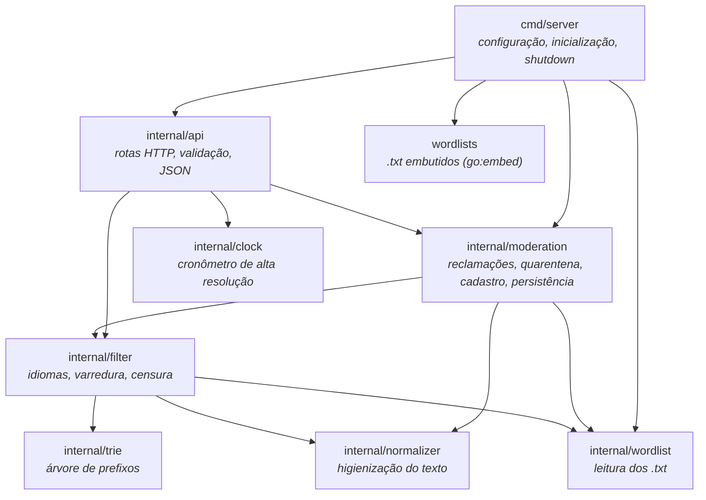
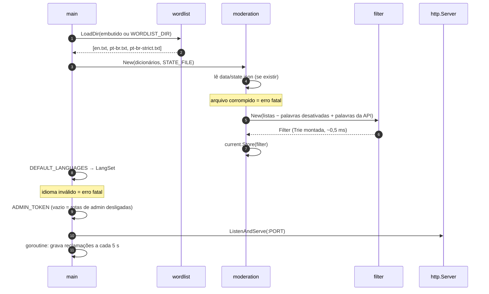
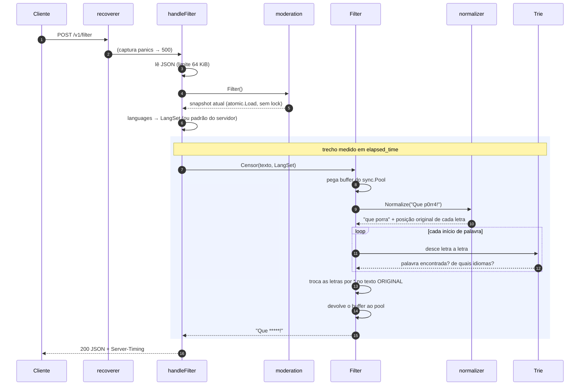
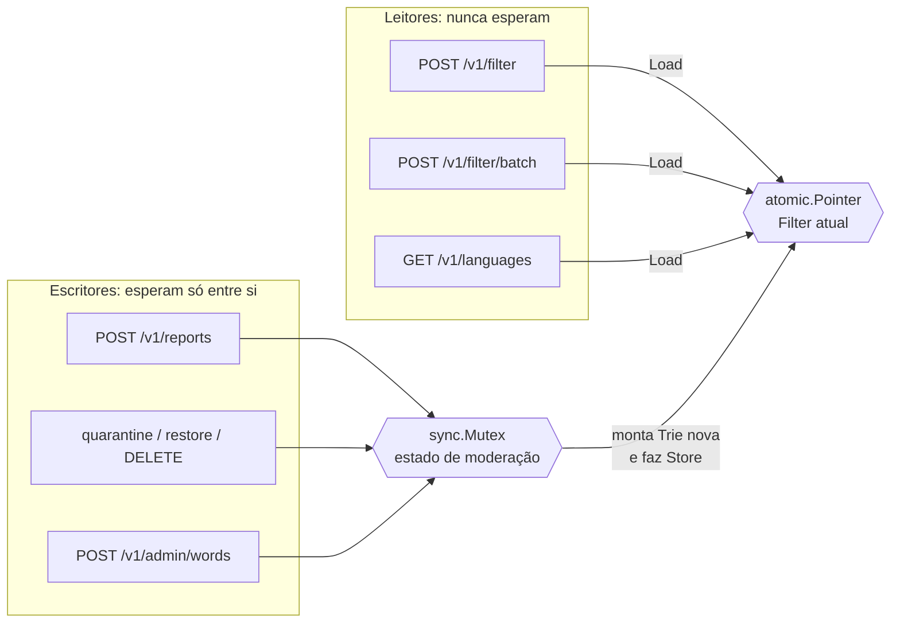
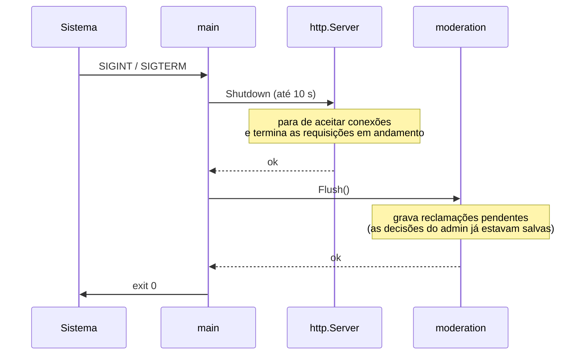

# Arquitetura

[← Voltar ao índice](README.md)

- [Pacotes](#pacotes)
- [Inicialização](#inicialização)
- [O caminho de uma requisição](#o-caminho-de-uma-requisição)
- [Concorrência: quem espera por quem](#concorrência-quem-espera-por-quem)
- [Desligamento](#desligamento)

---

## Pacotes

Cada pacote tem uma responsabilidade só, e as dependências apontam sempre "para baixo": o motor de busca (`trie`, `normalizer`) não sabe que existe HTTP.

| Pacote | Responsabilidade | Arquivo principal |
|---|---|---|
| `cmd/server` | Lê variáveis de ambiente, monta tudo, sobe o servidor e desliga com segurança | [main.go](../cmd/server/main.go) |
| `internal/api` | Recebe HTTP, valida, chama o serviço e formata a resposta | [handler.go](../internal/api/handler.go), [moderation.go](../internal/api/moderation.go) |
| `internal/moderation` | Dono da Trie "viva": aplica decisões do admin e grava o estado | [moderation.go](../internal/moderation/moderation.go) |
| `internal/filter` | Junta normalização + Trie + idiomas e produz o texto censurado | [filter.go](../internal/filter/filter.go) |
| `internal/trie` | A árvore de prefixos com uma máscara de idiomas em cada palavra | [trie.go](../internal/trie/trie.go) |
| `internal/normalizer` | Converte o texto bruto na forma canônica, lembrando a posição original | [normalizer.go](../internal/normalizer/normalizer.go) |
| `internal/wordlist` | Lê um `<idioma>.txt` por idioma de qualquer `fs.FS` | [wordlist.go](../internal/wordlist/wordlist.go) |
| `internal/clock` | Mede microssegundos com precisão, inclusive no Windows | [clock.go](../internal/clock/clock.go) |

### Por que `cmd/` e `internal/`?

O projeto segue o layout padrão da comunidade Go:

| Pasta | Convenção | Aqui |
|---|---|---|
| `cmd/<nome>/` | Cada subpasta é **um executável**, e o nome dela vira o nome do binário | `cmd/server/` → `server.exe`. Uma ferramenta de linha de comando, por exemplo, entraria como `cmd/check/` reaproveitando o mesmo `internal/` |
| `internal/` | Código que **só este módulo pode importar**: o compilador Go bloqueia imports vindos de outros projetos | Todo o motor e a API. Nada aqui é uma biblioteca pública com compromisso de compatibilidade |
| `api/` | Contratos da API (OpenAPI, protobuf…) | `openapi.yaml` |
| `docs/` | Documentação | Estes arquivos |

Com isso, `main.go` fica pequeno: só lê a configuração e conecta as peças. Toda a lógica vive em pacotes testáveis dentro de `internal/`.

---

## Inicialização

Tudo que é caro acontece **uma vez**, antes de o servidor aceitar a primeira requisição. Erros de configuração derrubam o processo na hora (*fail fast*), em vez de aparecerem em produção.

| Variável | Padrão | Lida em |
|---|---|---|
| `PORT` | `8080` | criação do `http.Server` |
| `WORDLIST_DIR` | listas embutidas | `wordlist.LoadDir` |
| `STATE_FILE` | `data/state.json` | `moderation.New` |
| `DEFAULT_LANGUAGES` | todos menos `*-strict` | `filter.Resolve` |
| `ADMIN_TOKEN` | vazio (admin desligado) | `api.Config` |

---

## O caminho de uma requisição

Exemplo: `POST /v1/filter` com `{"text": "Que p0rr4!"}`.

**O que é medido em `elapsed_time`:** só o algoritmo (normalizar, varrer, censurar). Ler o JSON e enviar a resposta pela rede ficam de fora, de propósito: assim o número reflete o motor, não a rede.

**Por que o texto limpo não aloca memória:** se nenhuma palavra é encontrada, `Censor` devolve a própria string de entrada, sem cópia. O buffer de normalização vem de um `sync.Pool` e volta para ele.

---

## Concorrência: quem espera por quem

O servidor atende muitas requisições ao mesmo tempo. O desenho garante que **filtrar texto nunca espera por nada**:

| Recurso | Proteção | Por quê |
|---|---|---|
| Trie em uso | Nenhuma: é imutável | Ninguém altera uma Trie publicada; mudanças criam outra |
| Ponteiro para a Trie atual | `atomic.Pointer` | Trocar o ponteiro é uma única instrução atômica |
| Mapas de moderação | `sync.Mutex` | Só as escritas (reclamações e admin) passam por ele |
| Buffers de normalização | `sync.Pool` | Cada requisição pega o seu; não há compartilhamento |

Detalhes da troca da Trie estão em [Moderação → Copy-on-write](moderacao.md#copy-on-write-trocando-a-trie-sem-parar-o-servidor).

---

## Desligamento

Ao receber `Ctrl+C` (`SIGINT`) ou `SIGTERM`:

Se o processo for **morto à força** (sem sinal), perdem-se no máximo os últimos 5 s de reclamações. Decisões do admin e palavras cadastradas nunca se perdem, porque são gravadas antes de a API responder.
