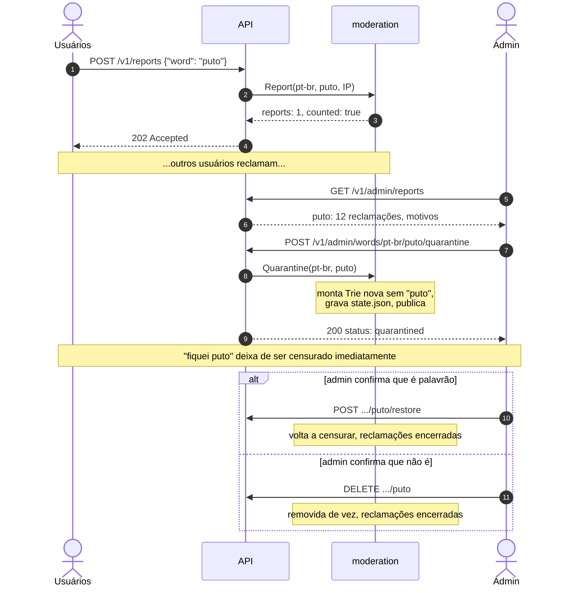
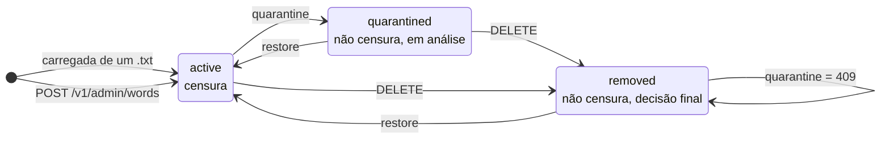
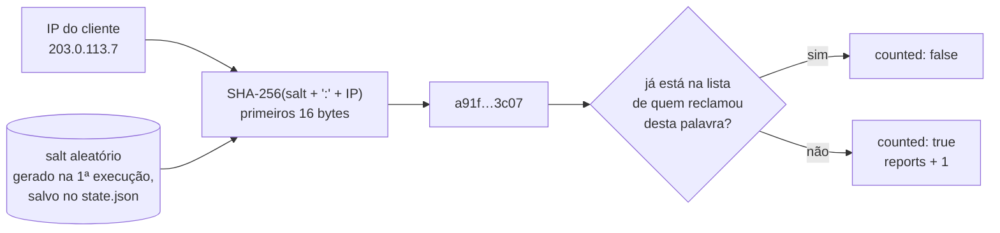
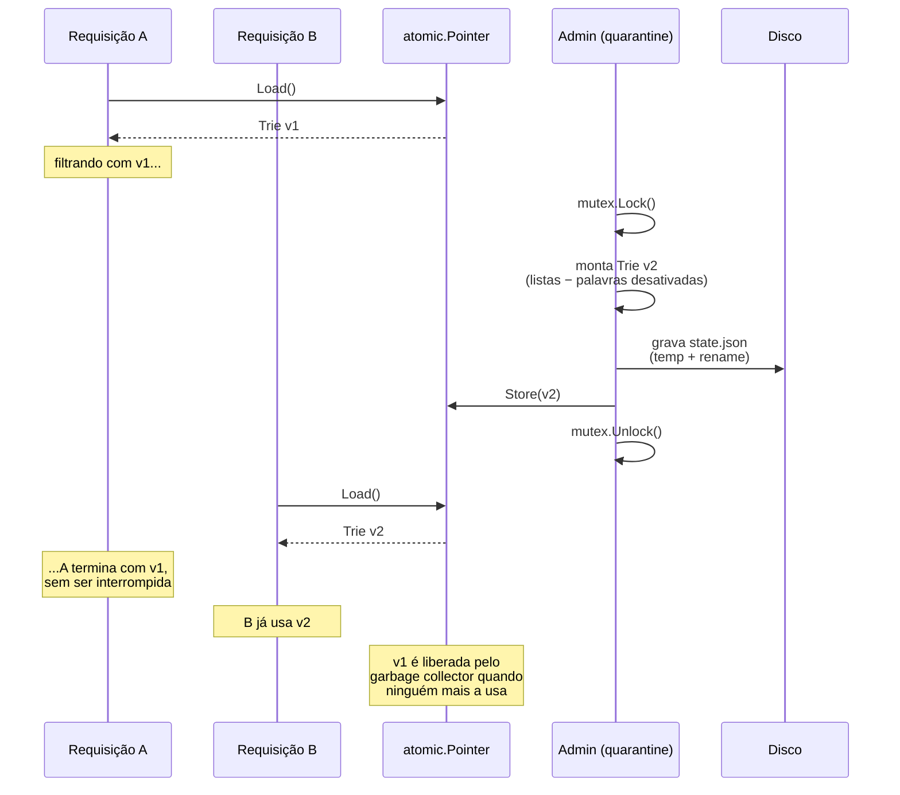
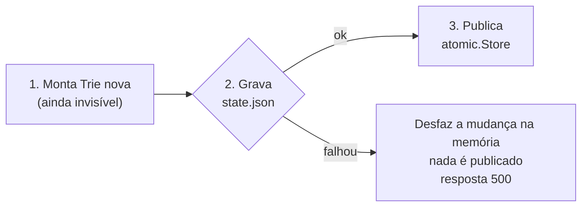
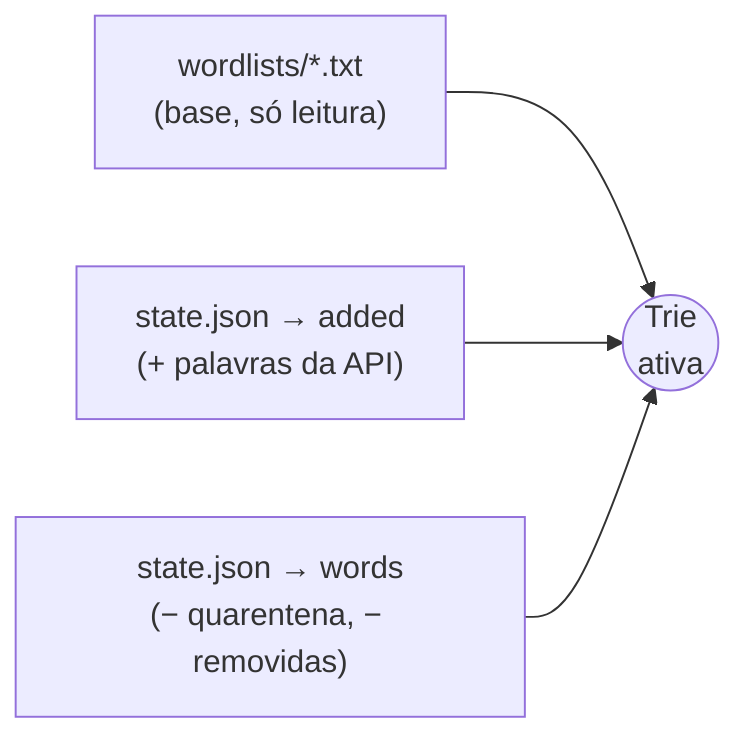
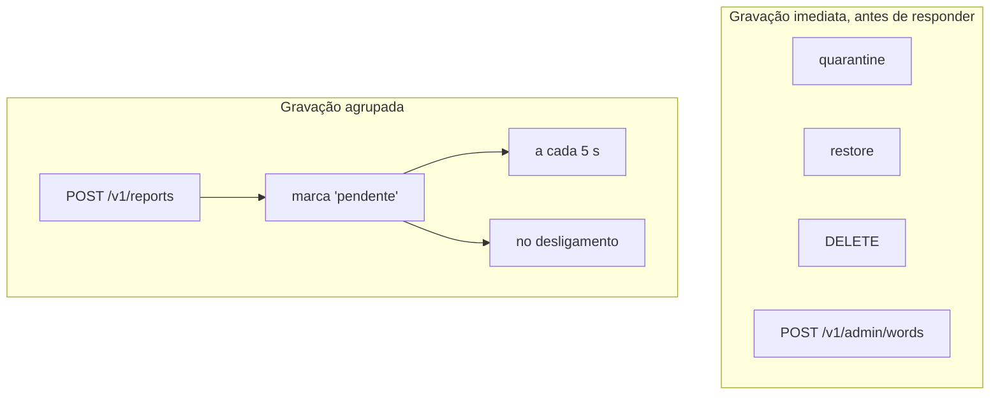
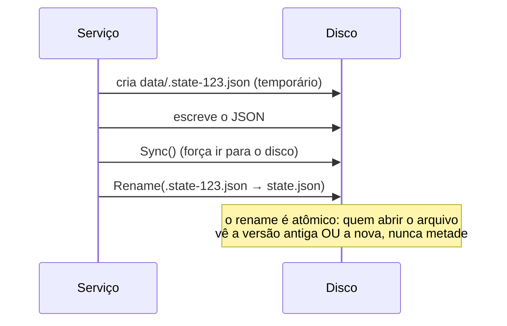

# Moderação

[← Voltar ao índice](README.md)

Como palavras são reclamadas, suspensas, removidas e cadastradas **com o servidor rodando**, sem deixar a filtragem mais lenta.

Código: [internal/moderation/moderation.go](../internal/moderation/moderation.go)

- [O fluxo completo](#o-fluxo-completo)
- [Estados de uma palavra](#estados-de-uma-palavra)
- [Um voto por cliente](#um-voto-por-cliente)
- [Copy-on-write: trocando a Trie sem parar o servidor](#copy-on-write-trocando-a-trie-sem-parar-o-servidor)
- [Persistência](#persistência)
- [Decisões de design](#decisões-de-design)

---

## O fluxo completo



---

## Estados de uma palavra



| Estado | Censura? | Aceita reclamações? | Reclamações existentes |
|---|---|---|---|
| `active` | sim | sim | acumulando |
| `quarantined` | não | não (`409`) | **mantidas** como evidência para a análise |
| `removed` | não | não (`409`) | encerradas |

| Ação | O que acontece com as reclamações |
|---|---|
| `quarantine` | Mantidas |
| `restore` | Encerradas: o admin decidiu que **é** palavrão |
| `DELETE` | Encerradas: o admin decidiu que **não é** palavrão |

**Palavras cadastradas pela API** seguem o mesmo ciclo, com uma diferença: o `DELETE` as apaga por completo (não ficam como `removed`), porque não existe um `.txt` para onde "voltar". Elas podem ser cadastradas de novo depois.

---

## Um voto por cliente

Sem proteção, uma pessoa só poderia mandar 1000 reclamações e empurrar qualquer palavra para o topo da fila. Por isso cada cliente conta **uma vez por palavra**:



- **Sem dados pessoais no disco:** o `state.json` guarda o hash, nunca o IP.
- **Por que *salt*:** existem só ~4 bilhões de IPv4, e um hash puro poderia ser revertido testando todos. Com um *salt* secreto, isso fica inviável.
- **Por que o *salt* é salvo:** se fosse gerado a cada execução, o mesmo IP teria outro hash depois de um reinício e poderia votar de novo.
- **Limites:** até 10.000 clientes distintos e os 10 motivos mais recentes por palavra, com até 280 caracteres cada.

> A quarentena **nunca é automática**. Se 500 reclamações liberassem uma palavra sozinhas, um grupo organizado poderia liberar qualquer palavrão. A fila só informa; quem decide é o admin.

---

## Copy-on-write: trocando a Trie sem parar o servidor

A Trie é lida por todas as requisições **sem nenhuma trava**, e é isso que garante latência de microssegundos. Alterá-la com o servidor rodando exigiria uma trava em toda leitura. A solução é nunca alterar: **montar uma nova e trocar o ponteiro**.



**A ordem importa: montar → gravar → publicar.**



Se a gravação falhar, nada é publicado e a mudança em memória é desfeita. Assim, **memória, disco e Trie em uso nunca discordam**. Se a ordem fosse "publicar e depois gravar", uma falha de disco deixaria o servidor obedecendo a uma regra que sumiria no próximo reinício.

| | Mutex em toda leitura | **Copy-on-write** |
|---|---|---|
| Custo de uma leitura | lock + unlock | uma leitura atômica |
| Leitura durante uma mudança | espera | não espera |
| Custo de uma mudança | baixo | monta a Trie (~0,5 ms) |
| Adequado quando | escritas frequentes | **leituras ≫ escritas** (o caso aqui) |

Um teste ([moderation_test.go](../internal/moderation/moderation_test.go) → `TestReadersNeverSeeAPartialTrie`) alterna quarentena e restore 200 vezes enquanto 8 goroutines filtram texto sem parar, verificando que nenhuma leitura vê um estado intermediário.

---

## Persistência

Os `.txt` são a **base** e nunca são alterados. As mudanças ficam num arquivo separado, aplicado **por cima** da base na inicialização:



### Formato do `state.json`

```json
{
  "version": 1,
  "salt": "e7422118ba5de63494ea343c08641daa",
  "words": [
    { "language": "pt-br", "word": "puto", "status": "quarantined", "updated_at": "2026-11-09T00:23:02Z" }
  ],
  "added": [
    { "language": "pt-br", "word": "mané", "added_at": "2026-11-09T00:32:39Z" }
  ],
  "reports": [
    { "language": "pt-br", "word": "puto",
      "reporters": ["a91f0c...", "77be12..."],
      "reasons": ["em PT-PT puto = menino"],
      "first_reported_at": "2026-11-09T00:23:01Z", "last_reported_at": "2026-11-09T00:25:40Z" }
  ]
}
```

### Quando o arquivo é gravado



- **Decisões do admin** são gravadas antes da resposta `200`. Se a API respondeu, a mudança está no disco.
- **Reclamações** são agrupadas: 1000 reclamações num segundo viram uma gravação, não 1000.

### Escrita atômica



Se o processo cair no meio da escrita, o `state.json` antigo continua intacto. Um arquivo corrompido (editado à mão, por exemplo) **impede o servidor de subir**, em vez de ser ignorado e apagar as decisões em silêncio.

---

## Decisões de design

| Decisão | Alternativa descartada | Motivo |
|---|---|---|
| Quarentena só manual | Automática após N reclamações | Reclamações em massa liberariam palavrões |
| 1 voto por IP (hash com salt) | Contar toda reclamação | Uma pessoa só não pode inflar a fila |
| Copy-on-write com `atomic.Pointer` | `sync.RWMutex` na Trie | Leituras são milhares de vezes mais frequentes que mudanças |
| Estado em arquivo separado | Editar os `.txt` | A base fica versionada no git; as decisões são dados de execução |
| Montar → gravar → publicar | Publicar → gravar | Uma falha de disco não pode deixar memória e disco divergentes |
| Recusar texto com encoding errado | "Consertar" removendo o caractere | `mané` corrompido viraria `man` e censuraria inglês |
| Normalizar palavras nas rotas | Comparar como foi digitado | `V4CA`, `vaca` e `váca` são a mesma palavra para o filtro |

**Limitação conhecida:** o estado é um arquivo local, ou seja, um por instância. Com vários servidores atrás de um *load balancer*, ele precisaria ir para um banco compartilhado (Postgres/Redis), com *pub/sub* avisando as instâncias para reconstruírem a Trie.
