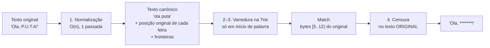
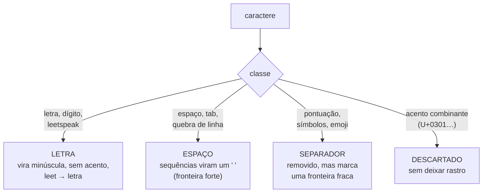
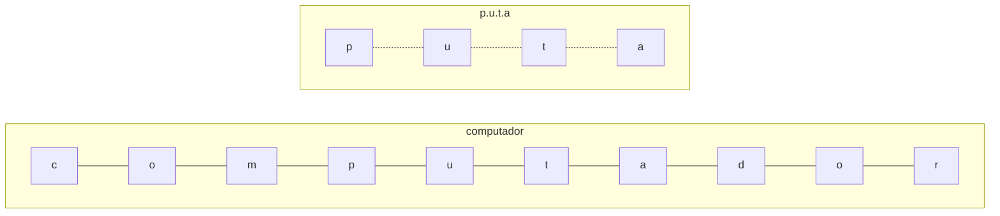
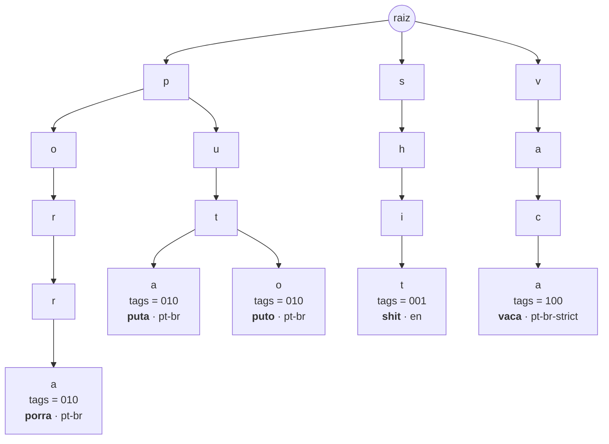
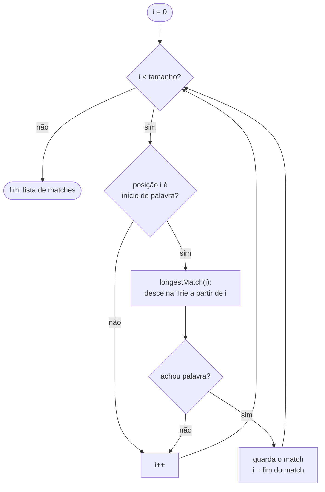
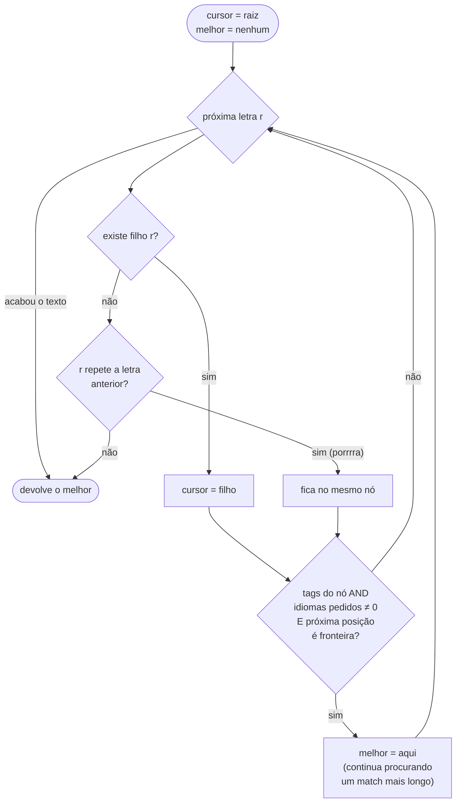

# Motor de busca

[← Voltar ao índice](README.md)

Como um texto vira `has_profanity` + `censored_text` em microssegundos.

- [Visão geral](#visão-geral)
- [1. Normalização](#1-normalização)
- [2. A Trie](#2-a-trie)
- [3. Varredura](#3-varredura)
- [4. Censura no texto original](#4-censura-no-texto-original)
- [Exemplo completo, passo a passo](#exemplo-completo-passo-a-passo)
- [Complexidade](#complexidade)

---

## Visão geral



---

## 1. Normalização

Código: [internal/normalizer/normalizer.go](../internal/normalizer/normalizer.go)

Cada caractere do texto cai em **uma de quatro classes**:



| Regra | Entrada | Saída |
|---|---|---|
| Minúsculas | `MERDA` | `merda` |
| Leetspeak | `0 1 3 4 5 7 @ $` | `o i e a s t a s` |
| Acentos | `Desgraçado` | `desgracado` |
| Separadores | `p.u.t.a`, `c*a*r*a*l*h*o` | `puta`, `caralho` |
| Espaços | `"a   \t b"` | `"a b"` |

**Desempenho:** a classificação dos 384 primeiros caracteres Unicode (ASCII, Latin-1 e Latin Extended-A, que cobrem todo o português) é **pré-calculada numa tabela**. Classificar um caractere custa um acesso a array. Os demais passam pelo caminho lento (tabelas Unicode do Go), que continua correto.

### A normalização lembra de onde cada letra veio

Para censurar o texto **original** (mantendo acentos e pontuação das partes limpas), cada letra normalizada guarda o intervalo de bytes que ela ocupava:

```
original:     O  l  á  ,     P  .  U  .  T  .  A  !
bytes:        0  1  2-3 4 5  6  7  8  9  10 11 12 13
                 
normalizado:  o  l  a     ␣  p     u     t     a
Span:        [0,1)[1,2)[2,4) [5,6)[6,7) [8,9) [10,11) [12,13)
SoftBreak:                    ·      ✓     ✓      ✓
```

- `á` ocupa **2 bytes** em UTF-8, então o `a` normalizado aponta para `[2,4)`.
- `SoftBreak ✓` indica que um separador foi removido logo antes daquela letra.

### Fronteiras de palavra

Uma palavra só pode **começar e terminar** numa fronteira. É isso que separa `p.u.t.a` (detectado) de `computador` (não detectado):



Em `computador` não há fronteira antes do `p` nem depois do `a`, então "puta" não pode casar ali. Em `p.u.t.a` os pontos viraram fronteiras fracas (linha tracejada), e a palavra inteira, de borda a borda, casa.

| Posição | É fronteira? |
|---|---|
| Início ou fim do texto | sim |
| Antes ou depois de um espaço | sim |
| Onde um separador foi removido (`.` `,` `!` `*` `-`…) | sim |
| Entre duas letras coladas | **não** |

---

## 2. A Trie

Código: [internal/trie/trie.go](../internal/trie/trie.go)

Cada nível da árvore é uma letra. Palavras com o mesmo começo **compartilham nós**, e cada nó onde uma palavra termina guarda uma **máscara de bits dos idiomas** a que ela pertence:



| Bit | Idioma | Opcional? |
|---|---|---|
| `001` (bit 0) | `en` | não |
| `010` (bit 1) | `pt-br` | não |
| `100` (bit 2) | `pt-br-strict` | sim |

Os bits seguem a ordem alfabética dos arquivos. O padrão do servidor (todos menos os opcionais) é `011`.

### Por que uma Trie só, e não uma por idioma

| | Uma Trie por idioma | **Uma Trie com máscara** |
|---|---|---|
| Requisição com 3 idiomas | Varre o texto 3 vezes e mescla os resultados | Varre **1 vez** |
| Filtrar por idioma | Escolher quais árvores percorrer | Um `AND` de bits por palavra candidata |
| Palavra em 2 idiomas | Duplicada | Um nó, 2 bits ligados |
| `detected_languages` | Juntar listas | `OR` das máscaras encontradas |

### Estrutura de um nó

```go
type node struct {
    children [27]*node      // 'a'..'z' + ' ': índice direto, sem hash
    extra    map[rune]*node // outros caracteres (dígitos, outros alfabetos)
    tags     Tags           // != 0 → uma palavra termina aqui
}
```

Depois da normalização, quase todo caractere é `a`–`z` ou espaço, e descer um nível é **um acesso a array**. O `map` só é criado nos raros nós que precisam dele.

---

## 3. Varredura

Código: [internal/filter/filter.go](../internal/filter/filter.go) → `scan` e `longestMatch`



### `longestMatch`: descer na Trie



Três regras importantes:

1. **Match mais longo:** em `filho da puta`, o algoritmo não para em `filho`. Ele continua e prefere a expressão inteira.
2. **Letras esticadas:** se a letra não tem aresta mas repete a anterior, o cursor fica parado. `porrrraaa` casa com `porra` sem cadastrar variações. Como a aresta real tem prioridade, `porra` (com `rr` legítimo) continua funcionando.
3. **Idioma é só um `AND`:** uma palavra que existe só num idioma não pedido simplesmente não conta como fim de palavra nesta requisição.

---

## 4. Censura no texto original

Os matches estão em posições do texto **normalizado**. Os `Span`s convertem para bytes do **original**, e cada caractere daquele trecho vira `*`, exceto espaços (para `filho da puta` → `***** ** ****`):

```
normalizado: o l a ␣ p u t a        match: índices 4..7
                     │     │
Span[4].Start = 5 ───┘     └─── Span[7].End = 12

original:  "Ola, P.U.T.A!"
                 ^^^^^^^        bytes [5, 12)
resultado: "Ola, *******!"      um * por caractere, inclusive os pontos
```

---

## Exemplo completo, passo a passo

Entrada: `"Que p0rrr4!"`, idiomas `pt-br`.

**1. Normalização**

| Original | `Q` | `u` | `e` | ` ` | `p` | `0` | `r` | `r` | `r` | `4` | `!` |
|---|---|---|---|---|---|---|---|---|---|---|---|
| Classe | letra | letra | letra | espaço | letra | leet | letra | letra | letra | leet | separador |
| Normalizado | `q` | `u` | `e` | `␣` | `p` | `o` | `r` | `r` | `r` | `a` | — |

Resultado: `que porrra`. O `!` final foi removido e marca uma fronteira.

**2. Varredura**

| i | Início de palavra? | Descida na Trie | Resultado |
|---|---|---|---|
| 0 (`q`) | sim (início do texto) | `q`: sem filho | nada |
| 1–2 | não (letras coladas) | — | — |
| 3 (`␣`) | é espaço | — | — |
| 4 (`p`) | sim (depois de espaço) | `p → o → r → r`, depois `r` repetido: **fica**, depois `a` → tags `010`, fim do texto = fronteira | **match 4..9** |

**3. Censura:** posições 4..9 correspondem aos bytes `[4, 10)` do original, `p0rrr4`, que viram 6 asteriscos.

**Saída:** `"Que ******!"`

---

## Complexidade

| Etapa | Custo | Observação |
|---|---|---|
| Montar a Trie | O(soma dos tamanhos das palavras) | Uma vez, ~0,5 ms para ~400 palavras |
| Normalizar | O(n) | Uma passada, n = tamanho do texto |
| Varrer | O(n · L) | L = tamanho da maior palavra. **Não depende de quantas palavras existem.** |
| Censurar | O(n) | Uma passada |
| Memória por requisição | O(n) | Buffers reaproveitados via `sync.Pool`; texto limpo = 0 alocações |

Comparação com as alternativas:

| Abordagem | Custo por texto | De 10 para 10.000 palavras |
|---|---|---|
| `LIKE '%palavra%'` no banco | ida e volta na rede + O(W · n) | ~1000× mais trabalho (teórico) |
| Loop de `strings.Contains` | O(W · n) | ~1000× mais trabalho (teórico) |
| **Trie** | **O(n · L)** | **~12% mais lento** (efeito de cache, medido em benchmark) |
